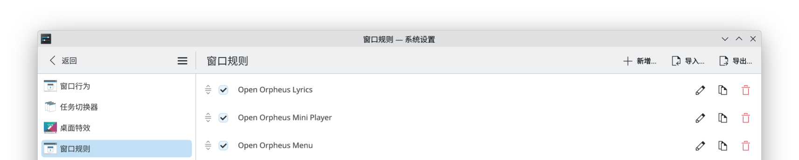
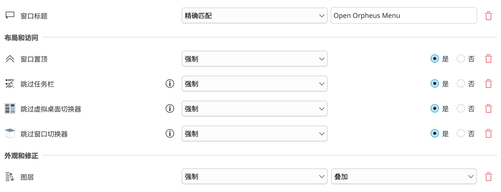
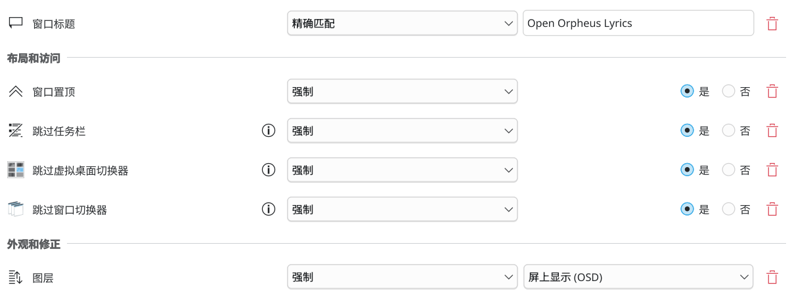

# WM 窗口规则配置

由于 Wayland 协议的限制，Open Orpheus 无法自动完成部分窗口属性的设置，可能会严重影响使用体验。该文档将帮助你通过 WM 自带的窗口规则，优化 Open Orpheus 在 Wayland 环境下的使用体验。

本文档在窗口规则的配置中，将仅通过窗口标题对 Open Orpheus 的对应窗口进行匹配。此外，本文档的窗口规则仅作为参考建议，你也可以自行调整优化，使其更符合你的使用习惯。

在 niri、sway 与 river 上，桌面歌词窗口会以合成器的 overlay 层呈现：位置和尺寸由应用自己管理（拖动、缩放、横竖切换后都会记住，下次启动回到原位），层级由合成器保证（全屏窗口也盖不住它），因此不需要任何窗口规则。

为什么只有这几个：layer surface 的位置就是它的 margin，拖动是应用替合成器重放的，所以合成器必须在承载新 margin 的那次 commit 上就把 surface 摆过去。实测：niri、sway、river 跟手；Hyprland 追不上指针；labwc、Wayfire 拖动时会抖；KWin 根本不重排，窗口自始至终追不上。这些都不是「支不支持 layer shell」的问题，而是重排时机的问题，协议里也没有任何回报可用于判断，所以只能按实测列出来。名单外的合成器想试可以设 `LYRICS_LAYER_SHELL=1`（想关掉设 `0`）。本页「桌面歌词」一节对没有走 overlay 的合成器照旧生效。

## KDE

KDE 的窗口规则设置可在 `系统设置 > 应用和窗口 > 窗口管理 > 窗口规则` 中找到。



以下是 KDE 环境下建议的窗口规则配置：

### 菜单



<details>
<summary>文本描述</summary>

#### 窗口匹配

- 窗口标题：`精确匹配` `Open Orpheus Menu`

#### 布局和访问

- 窗口置顶：`强制` `是`
- 跳过任务栏：`强制` `是`
- 跳过虚拟桌面切换器：`强制` `是`
- 跳过窗口切换器：`强制` `是`

#### 外观和修正

- 图层：`强制` `叠加`

</details>

### 迷你播放器


<details>
<summary>文本描述</summary>

#### 窗口匹配

- 窗口标题：`精确匹配` `Open Orpheus Mini Player`

#### 布局和访问

- 窗口置顶：`强制` `是`

</details>

### 桌面歌词



<details>
<summary>文本描述</summary>

#### 窗口匹配

- 窗口标题：`精确匹配` `Open Orpheus Lyrics`

#### 布局和访问

- 窗口置顶：`强制` `是`
- 跳过任务栏：`强制` `是`
- 跳过虚拟桌面切换器：`强制` `是`
- 跳过窗口切换器：`强制` `是`

#### 外观和修正

- 图层：`强制` `屏上显示（OSD）`

</details>

上面这几个合成器上不需要以上规则。

layer surface 只能待在合成器分给它的那块输出上，协议里没有换输出的请求，所以拖动本身换不了屏：拖到边缘会停住，窗口**整个**留在屏内——不留一截在边缘外，因为那截透明、不接受鼠标，用户就没法把它抓回来了（而且合成器会把「锚在左上」的 surface 缩到屏幕剩下的宽度，于是窗口会被越拖越窄）。窗口贴住屏幕边之后，光标越过屏幕交界线的那一刻正好就是光标离开窗口的那一刻，此时松手，应用会把歌词窗口销毁重建到光标所在的那块屏幕上，贴着推过去的那条边——所以拖到哪块屏就落在哪块屏。会闪一下，而且这次拖动会中断，需要再拖一次继续微调。光标又回到窗口里再松手就什么都不做。

同一次拖动可能连着报几次推挤（窗口在按着不放的指针底下被换掉了，新的那个又被拖到同一条边上），所以同一时间只允许一次跳屏，其余丢掉；而且只有**当前**这个歌词窗口报的推挤才算数——被换掉的旧窗口还留在屏幕上时，它会继续报它当初那条边，跟着它走会把歌词又搬回去。

窗口的位置是按「某一块屏幕的角」记的，所以换过屏幕、拔过线之后记住的位置可能不在这块屏上。这种情况下窗口会被拉回屏内，位置整个放不下就回到默认位置（主屏底部居中），不会出现「启动了但看不见歌词」；比屏幕还大的窗口会被缩到屏幕大小（否则合成器会自己缩，原生层记的几何就跟实际对不上了）。

## niri

niri 下光标交互无法穿透到浮动窗口下方，关闭菜单只能通过 Esc 按键。

### 菜单

```kdl
window-rule {
  match title="^Open Orpheus Menu$"

  open-floating true

  default-floating-position x=0 y=0 relative-to="top"
  default-window-height { proportion 1.0; }
  default-column-width { proportion 1.0; }

  focus-ring {
    off
  }

  border {
    off
  }
}
```

### 迷你播放器

```kdl
window-rule {
  match title="^Open Orpheus Mini Player$"

  open-floating true

  focus-ring {
    off
  }

  border {
    off
  }
}
```

### 桌面歌词

这些合成器上不需要以下规则：歌词窗口以 overlay 层呈现，由应用自己摆放。这时该用 niri 的 layer 规则，按命名空间匹配（`niri msg layers` 可以看到）：

```kdl
layer-rule {
  match namespace="^open-orpheus-lyrics$"

  // 例如录屏时不把歌词录进去
  block-out-from "screencast"
}
```

透明度、阴影、圆角、背景模糊等属性都可用，窗口规则做不到这些。

其他合成器（KDE、GNOME，或设置了 `LYRICS_LAYER_SHELL=0`）沿用以下窗口规则：

```kdl
window-rule {
  match title="^Open Orpheus Lyrics$"

  open-floating true

  focus-ring {
    off
  }

  border {
    off
  }
}
```

## 通用信息

对于其他没有提及到的 WM，你也可以根据以下信息自行配置。

### 窗口标题

| 窗口       | 标题                     |
| ---------- | ------------------------ |
| 菜单       | Open Orpheus Menu        |
| 迷你播放器 | Open Orpheus Mini Player |
| 桌面歌词   | Open Orpheus Lyrics      |

### 环境变量

| 变量                            | 描述                                               | 备注                                              |
| ------------------------------- | -------------------------------------------------- | ------------------------------------------------- |
| `MENU_OVERLAY_NO_FULLSCREEN`    | 禁用菜单全屏                                       | 对全屏窗口背景不透明的 WM 默认激活，如非 KDE 桌面 |
| `MENU_OVERLAY_FORCE_FULLSCREEN` | 强制启用菜单全屏                                   |                                                   |
| `MENU_OVERLAY_NO_MAXIMIZE`      | 禁用菜单自动最大化                                 | 对部分 Tiling WM 默认激活，如 niri                |
| `MENU_OVERLAY_FORCE_MAXIMIZE`   | 强制启用菜单最大化（需要菜单全屏被禁用）           |                                                   |
| `LYRICS_LAYER_SHELL`            | 强制打开（`1`）/ 关闭（`0`）桌面歌词的 layer shell | 不设时只在上面列出的合成器上打开                  |
| `ORPHEUS_LAYER_DEBUG`           | 打印代理对 layer surface 拖动/缩放的处理           | 排查「拖动没有实时跟随」一类问题时使用            |
